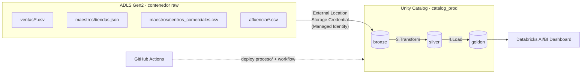
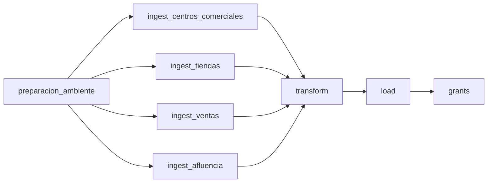

# 🛍️ ETL Ventas de Centros Comerciales – Azure Databricks

Pipeline ETL con **arquitectura Medallion** (raw → bronze → silver → golden) en **Azure Databricks + Unity Catalog**, con despliegue continuo mediante **GitHub Actions** y visualización en **Databricks AI/BI Dashboards**.

> ⚠️ Los datos son **ficticios** y se generaron con `scripts/generar_datos.py` con fines académicos. No representan cifras reales de Jockey Plaza, Mall Plaza, Larcomar, MegaPlaza ni Plaza San Miguel.

Trabajo final del programa *Ingeniería de Datos e IA con Databricks* (Smart Data).

---

## 🏛️ Arquitectura



| Componente | Servicio |
|---|---|
| Almacenamiento (raw, bronze, silver, golden, metastore) | Azure Data Lake Storage Gen2 |
| Autenticación al lago | **Access Connector for Azure Databricks (Managed Identity)** → Storage Credential → External Locations |
| Procesamiento | Azure Databricks (PySpark, Delta Lake, Auto Loader) |
| Gobierno | Unity Catalog (catálogos por ambiente, grants por grupo) |
| Orquestación | Databricks Workflows (job multi-tarea) |
| CI/CD | GitHub Actions |
| Visualización | Databricks AI/BI Dashboards |

**Ambientes:** `dev` (workspace de desarrollo, `catalog_dev`) y `prod` (workspace de producción, `catalog_prod`). Ambos workspaces comparten el metastore. **Solo el cluster de producción permanece encendido**: allí corre el workflow.

---

## 📦 Datasets (capa raw)

| Archivo | Formato | Ruta en `raw` | Filas | Descripción |
|---|---|---|---|---|
| `ventas_2025_parte1.csv`, `ventas_2025_parte2.csv` | CSV | `ventas/` | ~211k | Transacciones de venta (incluye duplicados, nulos, negativos y formatos inconsistentes a propósito) |
| `tiendas.json` | JSON multilínea | `maestros/` | 168 | Tiendas por centro comercial y rubro |
| `centros_comerciales.csv` | CSV | `maestros/` | 7 | Maestro de centros comerciales |
| `afluencia_visitantes.csv` | CSV | `afluencia/` | 2 555 | Visitantes diarios por centro comercial |

---

## 🥉🥈🥇 Capas

| Capa | Tablas | Qué se hace |
|---|---|---|
| **bronze** | `centros_comerciales`, `tiendas`, `ventas`, `afluencia` | Ingesta con schema explícito, columnas de auditoría. Ventas con **Auto Loader incremental** (`availableNow`) |
| **silver** | `dim_mall`, `dim_tienda`, `fact_ventas` (particionada por `anio, mes`), `afluencia_diaria` | Tipado, limpieza de nulos/negativos, normalización de texto, fechas en 2 formatos, deduplicación con **Window `row_number`**, **UDF**, joins **broadcast**, **MERGE** Delta |
| **golden** | `ventas_mensuales_mall`, `ranking_tiendas`, `conversion_diaria_mall`, `ventas_rubro_medio_pago` | Agregaciones, **Window `lag` / `rank`**, **pivot**, `cache`, **OPTIMIZE + ZORDER** |

---

## 📁 Estructura del repositorio

```
├── .github/workflows/deploy-prod.yml   # CI/CD: despliega proceso/, crea y ejecuta el workflow
├── proceso/                            # ÚNICOS notebooks que se despliegan y ejecutan en PROD
│   ├── 1.Preparacion_Ambiente.py       # External locations, catálogo, esquemas, DDL
│   ├── 2.Ingest_Centros_Comerciales.py
│   ├── 2.Ingest_Tiendas.py
│   ├── 2.Ingest_Ventas.py              # Auto Loader
│   ├── 2.Ingest_Afluencia.py
│   ├── 3.Transform.py                  # bronze -> silver
│   ├── 4.Load.py                       # silver -> golden
│   └── 5.Grants_Medallion.py           # permisos Unity Catalog
├── seguridad/Revoke_Grants.py          # auditoría y revocación de permisos
├── reversion/Drop_Medallion.py         # limpieza del ambiente
├── dashboard/consultas_dashboard.sql   # datasets del dashboard
├── datasets/                           # archivos que se suben al contenedor raw
├── scripts/generar_datos.py            # generador de datos ficticios
└── evidencias/                         # capturas (Azure, workflow, GitHub Actions, dashboard)
```

---

## 🔄 Workflow de Databricks (`WF_PROD_ETL_VENTAS_MALLS`)



## 🚀 CI/CD (GitHub Actions)

Cada `push` a `main` que modifique `proceso/` (o ejecución manual) hace lo siguiente:

1. Importa los notebooks de `proceso/` al workspace **prod** (`/Shared/ventas_malls/proceso`).
2. Busca el cluster de producción `cluster_prod_malls`.
3. Crea el workflow o, si ya existe, lo **actualiza** con `jobs/reset`, sin borrarlo.
4. Lo ejecuta con `run-now` y **monitorea cada tarea**. El pipeline de GitHub falla si alguna tarea falla.

**Secrets requeridos** (Settings → Secrets and variables → Actions):

| Secret | Valor |
|---|---|
| `DATABRICKS_HOST_PROD` | `https://adb-xxxxxxxx.xx.azuredatabricks.net` |
| `DATABRICKS_TOKEN_PROD` | Personal Access Token del workspace prod |

Los nombres de storage, catálogo, credencial y cluster se configuran en el bloque `env:` del workflow.

---

## 📊 Dashboard

Dashboard **Ventas Centros Comerciales** sobre `catalog_prod.golden`:
- KPIs: ventas totales, tickets, ticket promedio
- Evolución mensual de ventas por mall
- Top 5 tiendas por mall
- Tasa de conversión visitantes → compras (semana vs fin de semana)
- Medios de pago por rubro

Consultas en [`dashboard/consultas_dashboard.sql`](dashboard/consultas_dashboard.sql). Capturas en `evidencias/`.

---

## 🔐 Seguridad

- Acceso al lago **solo con Managed Identity** (Access Connector + rol *Storage Blob Data Contributor*). Sin access keys, SAS ni secrets en el código.
- Capa raw en ADLS (sin DBFS ni Volumes).
- `data_engineers`: lectura/escritura en las 3 capas · `analistas_malls`: solo lectura en `golden`.
